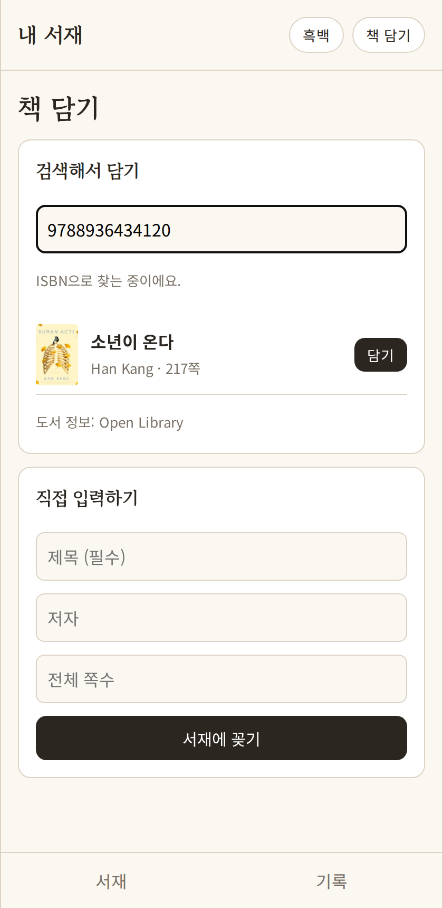

# 내 서재 (웹)

읽은 책과 밑줄 친 문장, 그때 든 생각을 책별로 모아 두는 개인 독서 기록 웹앱입니다.
오즈코딩스쿨 KDT **2차 프로젝트**입니다. 1차에서 Expo 앱으로 만든 ‘내 서재’를 수업에서 배운 React로 웹에 옮기고, 1차 발표 때 정한 다음 목표(실제 책 검색, 진도 갱신, 지난 기록 다시 만나기)를 구현했습니다.

**바로 열어 보기:** https://leeyuul0g-beep.github.io/my-library-web/

| 서재와 서랍 | 책 검색 | ISBN 검색 | 기록 탭 |
| --- | --- | --- | --- |
|  |  |  |  |

## 주요 기능

**2차에 새로 넣은 것**
- **실제 책 검색**: Open Library 공개 API로 제목·저자 검색, 표지 사진까지 담기
- **ISBN 검색**: 책 뒷면 바코드 아래 숫자(10·13자리)를 넣으면 그 책을 바로 찾음
- **진도 갱신**: 슬라이더 하나로 읽은 쪽수를 바로 저장
- **지난 기록 다시 만나기**: 기록 탭 맨 위에 예전 문장을 하나씩 보여 줌
- **웹 배포**: 설치 없이 휴대폰·PC 브라우저에서 바로 열림 (GitHub Pages)

**1차 앱에서 웹으로 옮긴 것**
- **서재와 책등**: 쪽수만큼 두꺼운 책등, 세로로 쓴 제목. 다 읽은 책은 점으로 표시
- **줄 아래 서랍**: 책을 누르면 그 줄 바로 아래에 저자·진도·기록 쓰기가 열리고, 꺼낸 자리는 점선으로 남음
- **책 담기**: 검색해서 담거나 직접 입력
- **기록 쓰기**: 밑줄 친 문장, 생각, 쪽수를 책에 붙여 저장
- **기록 모아보기**: 문장·생각·책 제목으로 전체 기록 검색
- **흑백 모드**: 버튼 하나로 화면 전체를 흑백으로 전환

## 실행 방법

```sh
npm install
npm run dev
```

브라우저에서 http://localhost:5173 을 엽니다. 데이터는 브라우저의 localStorage에 저장됩니다.
처음 실행하면 예시 책 6권과 기록 3개가 들어 있습니다(브라우저 저장소를 지우면 초기화).
책 검색은 인터넷이 필요하고, 연결이 없으면 내장된 예시 목록에서 찾습니다.

## 기술 스택

- React 18, Vite
- React Router (화면 4개: 서재 `/`, 책 담기 `/add`, 책 상세 `/books/:id`, 기록 `/records`)
- Context API + 직접 만든 `useLocalStorage` 훅
- `fetch` + `AbortController`로 Open Library 검색 (입력이 멈춘 뒤 0.4초 후 요청, 이전 요청 취소)
- GitHub Pages 배포 (`npm run deploy` → gh-pages 브랜치)

## 폴더 구조

```
src/
├─ App.jsx                 라우팅, 흑백 모드
├─ api/bookSearch.js       Open Library 검색, ISBN 판별, 표지 주소
├─ hooks/
│  ├─ LibraryContext.jsx   책·기록 상태와 추가/삭제 함수
│  ├─ useLocalStorage.js   localStorage 자동 저장 훅
│  └─ useBookSearch.js     검색 지연·취소·오프라인 대체
├─ pages/                  ShelfPage, AddBookPage, BookPage, RecordsPage
├─ components/             Header, TabBar, Spine, Drawer, Cover, ProgressInput, RecordCard
└─ data/                   예시 데이터, 검색용 도서 목록
```

## 1차 → 2차

| 1차 발표 때 정한 다음 목표 | 2차 결과 |
| --- | --- |
| 책 검색·바코드로 등록 | 구현: 실제 도서 API 검색 + ISBN 검색 + 표지 |
| 모든 화면을 서가 디자인으로 통일 | 구현: 4개 화면 같은 톤 |
| 진도 한 번에 갱신, 지난 기록 다시 만나기 | 구현: 서랍 안 슬라이더, 기록 탭 상단 |
| 실제 기기 검증, 계정 동기화 | 일부: 웹 배포로 기기 상관없이 열림 / 동기화는 3차 |

## 3차 계획

- [ ] 로그인과 서버 저장 (다른 기기에서 같은 서재)
- [ ] 카메라로 바코드 찍어서 담기, 한국 책 검색 정확도 높이기(카카오 책 검색)
- [ ] 기록에 사진 첨부
- [ ] 테스트(Vitest)와 PC 화면 레이아웃
