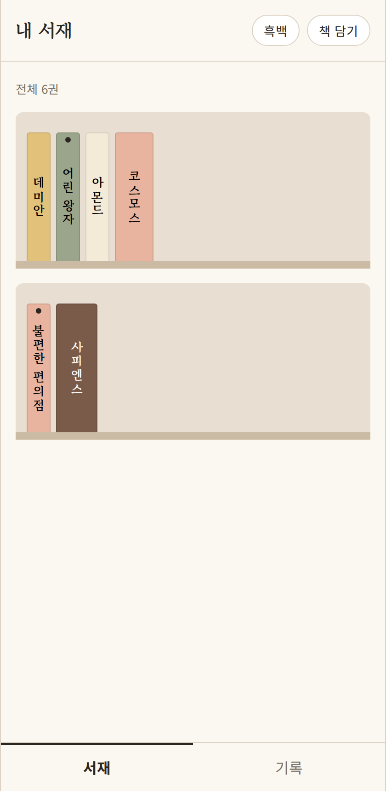
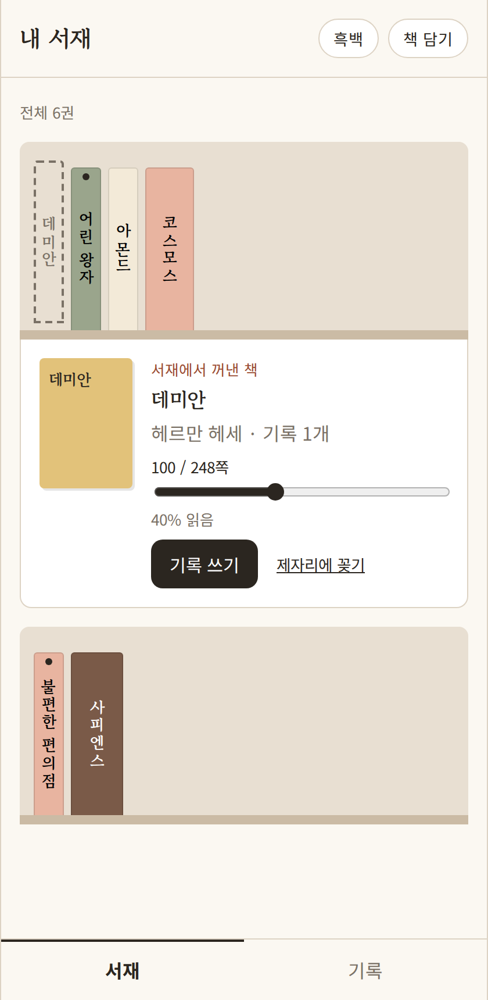
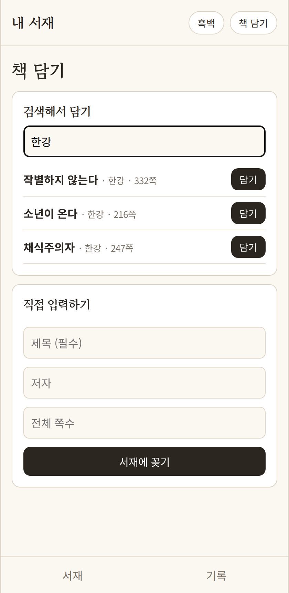
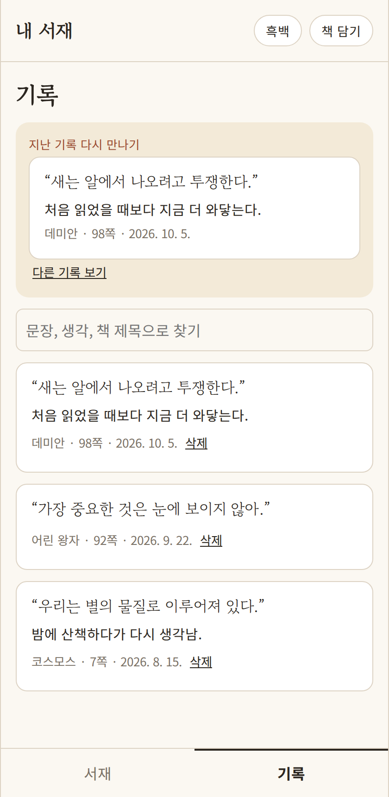

# 내 서재 (웹)

읽은 책과 밑줄 친 문장, 그때 든 생각을 책별로 모아 두는 개인 독서 기록 웹앱입니다.
오즈코딩스쿨 KDT **2차 프로젝트**로, 1차 때 기획한 ‘내 서재’의 핵심 흐름을 React로 구현했습니다.

| 서재 | 책을 꺼낸 서랍 | 책 검색 | 기록 탭 |
| --- | --- | --- | --- |
|  |  |  |  |

## 주요 기능

- **서재와 책등**: 쪽수만큼 두꺼운 책등, 세로로 쓴 제목. 다 읽은 책은 점으로 표시
- **줄 아래 서랍**: 책을 누르면 그 줄 바로 아래에 저자·진도·기록 쓰기가 열리고, 꺼낸 자리는 점선으로 남음
- **진도 갱신**: 슬라이더 하나로 읽은 쪽수를 바로 저장
- **책 담기**: 제목·저자 검색(예시 도서 목록) 또는 직접 입력
- **기록 쓰기**: 밑줄 친 문장, 생각, 쪽수를 책에 붙여 저장
- **기록 모아보기**: 전체 기록 검색, ‘지난 기록 다시 만나기’
- **흑백 모드**: 버튼 하나로 화면 전체를 흑백으로 전환

## 실행 방법

```sh
npm install
npm run dev
```

브라우저에서 http://localhost:5173 을 엽니다. 데이터는 브라우저의 localStorage에 저장됩니다.
처음 실행하면 예시 책 6권과 기록 3개가 들어 있습니다(브라우저 저장소를 지우면 초기화).

## 기술 스택

- React 18, Vite
- React Router (화면 4개: 서재 `/`, 책 담기 `/add`, 책 상세 `/books/:id`, 기록 `/records`)
- Context API + 직접 만든 `useLocalStorage` 훅

## 폴더 구조

```
src/
├─ App.jsx                 라우팅, 흑백 모드
├─ hooks/
│  ├─ LibraryContext.jsx   책·기록 상태와 추가/삭제 함수
│  └─ useLocalStorage.js   localStorage 자동 저장 훅
├─ pages/                  ShelfPage, AddBookPage, BookPage, RecordsPage
├─ components/             Header, TabBar, Spine, Drawer, ProgressInput, RecordCard
└─ data/                   예시 데이터, 검색용 도서 목록
```

## 1차 → 2차

| 1차 때 정한 다음 목표 | 2차 결과 |
| --- | --- |
| 책 검색으로 등록 | 구현 (예시 도서 목록 검색) |
| 진도를 한 번에 갱신 | 구현 (서랍 안 슬라이더) |
| 지난 기록 다시 만나기 | 구현 (기록 탭 상단) |
| 도서 API · 계정 동기화 | 3차 목표 |

## 3차 계획

- [ ] 도서 검색 Open API 연동
- [ ] 로그인과 서버 저장
- [ ] 배포와 반응형 레이아웃
- [ ] 기록에 사진 첨부
